# Idempotency Middleware Design

This document describes the implementation, its behavioral choices, and the limits of
its guarantees. See [README.md](README.md) for setup and usage.

## Scope and architecture

`New(store, next)` wraps an `http.Handler` and uses a shared, in-memory `Store` to
coordinate requests carrying an `Idempotency-Key` header. The intended use is retryable
POST endpoints, but the wrapper does not check the HTTP method: every keyed request
goes through the same logic. Requests with an empty or missing key pass through.

The implementation uses only the Go standard library:

| Component | Responsibility |
| --- | --- |
| [middleware.go](middleware.go) | Read and restore the request body, fingerprint requests, capture responses, and replay results |
| [store.go](store.go) | Atomically claim keys, publish results, abandon panicked executions, and remove records |
| [middleware_test.go](middleware_test.go) | Exercise replay, concurrency, failures, expiry, and independent keys |

An existing, unexpired record suppresses another execution for the same key and
fingerprint. This is a process-local guarantee while that record remains available.
Expiry, eviction, process restart, or abandonment after a panic can permit execution
again. The store does not make handler side effects transactional.

## Request lifecycle

1. If the key is empty, call the handler directly.
2. Read the entire request body. A read error returns `400 Bad Request` without
   creating a record. Restore the body so the handler can read the captured bytes.
3. Compute the fingerprint and atomically retrieve or create the key's record under
   the store mutex.
4. For an existing record, reject a fingerprint mismatch with `422 Unprocessable
   Entity`. Otherwise, wait for its result or the retry's context cancellation.
5. For a new record, run the handler with a buffering response writer. When it
   returns, publish the captured status, headers, and body, then replay them to the
   original caller. Waiting retries replay that same result.

```mermaid
stateDiagram-v2
    [*] --> InFlight: New key
    InFlight --> Done: Handler returns; close ready
    InFlight --> Absent: Handler panics; release waiters with 503
    Done --> Absent: TTL expiry or capacity eviction
    Absent --> InFlight: Next request claims key
```



The diagram shows the normal lifecycle. Lookup can also replace an expired in-flight
record; the consequences are described under retention below.

## Behavioral decisions

### Wait for an in-flight result

Each record has a `ready` channel. Matching retries wait until the original handler
finishes, then receive its captured response. This avoids requiring clients to poll
following an immediate conflict response.

The retry's context can interrupt the wait, producing `503 Service Unavailable`.
Canceling a waiter does not abandon the original execution. There is no middleware
timeout or waiter limit, so callers and the HTTP server need appropriate deadlines
and concurrency controls.

The store mutex protects map operations; it is released before handler execution or
waiting. Different keys can execute concurrently. Response fields are populated
before `ready` is closed, and waiting readers synchronize through that channel.

### Reject a reused key with a different fingerprint

The fingerprint is the hex-encoded SHA-256 hash of:

```text
method + NUL + URL.Path + NUL + raw body bytes
```

Separators distinguish field boundaries for ordinary HTTP methods and paths.
Bodies are compared byte for byte: equivalent JSON with different whitespace is a
different request. Query parameters, host, headers, and authenticated identity are
not included.

Keys occupy one namespace per `Store`, including across handlers sharing it. Clients
must use a unique key per logical operation. Applications must account for tenant
and user isolation when choosing the store and where authentication runs, since a
matching retry bypasses the wrapped handler.

A mismatch returns `422` immediately and leaves the existing record untouched.
Replaying despite a mismatch would hide client errors and could return a result for
another operation. An immediate `409` for an in-flight request is a possible API
policy, but this implementation waits for matching retries and uses `422` for
incompatible key reuse.

### Retain error responses

Every handler response is retained after the handler returns, including `4xx` and
`5xx`. A failure status does not prove that no side effect occurred: a charge may
have succeeded before a later operation failed. Deleting a record on `5xx` would
allow a retry to repeat that side effect.

On a handler panic, buffered output is not committed. The middleware removes the
active record, releases its waiters with a synthetic `503`, and re-panics so outer
recovery middleware or the HTTP server can handle the original request. A later
request may execute again. A panic can also occur after side effects, so this
recovery policy does not guarantee at-most-once side effects.

### Buffer responses before replay

The original caller and retries receive the captured status, header values, and body.
The body is copied on commit; the captured header map is retained. Handlers must
finish mutating their response before returning.

The writer implements `http.ResponseWriter`, without optional interfaces such as
`http.Flusher` or `http.Hijacker`. Streaming and upgraded connections are outside its
intended use. It also differs from the standard writer: `Write` does not implicitly
lock in status `200`, and headers are captured at handler return rather than
snapshotted at `WriteHeader`. Handlers relying on those details need additional
compatibility work.

Requests and responses are fully buffered, with no byte limit in the library.
Applications should bound request sizes and use it for responses small enough to
retain in memory.

## Retention and capacity

`NewStore(max, ttl)` creates a map and starts a background sweep every `ttl/2`.
Use a positive capacity and a TTL large enough that `ttl/2` is positive; constructor
arguments are not validated. There is currently no shutdown method for the sweeper,
so stores should be long-lived rather than created per request.

Expiry is set to creation time plus TTL, **not completion time plus TTL**. Lookup
removes an expired record and inserts a replacement, even if the previous handler
is still running. A handler that outlives the TTL can therefore overlap with a new
execution for the same key. The sweep only removes expired completed records.
Choose a TTL comfortably above the expected handler duration and retry window;
strict protection for long-running handlers would require changing this behavior.

At capacity, insertion attempts to evict an expired completed record first. Otherwise,
it evicts the completed record with the earliest **creation** time. This is not LRU
and is not ordered by completion time. The scan is O(n), avoiding the extra state
needed for a linked-list eviction policy.

Capacity eviction never selects an in-flight record. If all records are in flight,
insertion proceeds without eviction and the map can exceed `max`. The entry cap is
therefore a retention target rather than a hard memory bound. Even within that
target, response sizes and waiting goroutines remain unbounded. TTL alone would
also fail to bound peak memory; a strict bound needs admission control and byte limits.

Eviction can shorten the retry window below the configured TTL. Once a record is
gone, the next request is treated as new.

## Persistence and multiple instances

A shared durable backend would require more than replacing the map:

- **Atomic ownership:** claim a key together with its fingerprint and execution state,
  using a unique database constraint or a Redis conditional insert. Only the owner
  should publish or abandon that execution; use an ownership token to prevent stale
  workers from modifying replacement records.
- **Cross-process waiting:** replace local channels with polling, notifications, or an
  explicit in-flight response such as `409` with `Retry-After`. Blocking across nodes
  is possible, but needs a distributed result-notification mechanism.
- **Crash recovery:** define how an abandoned execution is detected and reclaimed.
  Lease expiry alone cannot prove that a side effect did not occur. Transactional
  integration with the business operation, or reconciliation, is needed for stronger
  guarantees.
- **Retention:** use backend-managed expiry and define whether retention starts at
  claim or completion. Keep result retention separate from execution leases, and
  account for eviction and durability guarantees of the chosen backend.
- **Request identity:** define tenant scoping and which query parameters or headers
  affect the operation before sharing a key namespace across instances.

## Validation and remaining gaps

Run the existing suite with:

```sh
go test -race ./...
```

It covers basic replay, concurrent matching requests, body mismatches, stored `5xx`,
panic recovery followed by re-execution, completed-record expiry, header replay, and
independent keys. The capacity test inserts beyond capacity but does not assert the
record count or eviction order.

Further tests would be needed for waiter cancellation, panic waiters, method and path
mismatches, handlers exceeding TTL, saturation with only in-flight entries, and
response-writer compatibility. These are limits of the current implementation;
this document introduces no runtime changes.
